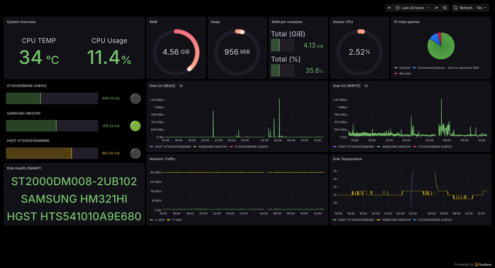

# Homelab

Lenovo ThinkStation P300 (E3-1226 v3, 12 GB RAM) running Debian and about 20 Docker containers at the moment. It has a 320 GB disk for the system and two more for data, 1 TB and 2 TB. All of them are HDD.

My personal files are in a gocryptfs volume, so they are encrypted on disk, and I mount it from my PC over NFS.

## Network

Only the WireGuard port is open to the internet. Once connected to the VPN I can reach my files and the rest of the local network. I can also send all my internet traffic through home.

The firewall is an [iptables script](scripts/network/iptables.sh) that drops everything by default and whitelists a handful of devices, two on the LAN plus my WireGuard clients. One of those clients is restricted to two services. Docker bypasses the INPUT chain for published ports, so the same whitelist is repeated in DOCKER-USER. SSH is only reachable from those devices too, and it needs a key and has fail2ban on top.

Pi-hole is my DNS server and blocks ads. My devices keep using it over WireGuard. Nginx Proxy Manager takes care of HTTPS, with a DDNS subdomain.

## Monitoring

Prometheus and Telegraf collect the metrics. Grafana shows them. If something goes wrong I get an alert on my phone.

## Backups

The server backs itself up every night at 04:00. Each step (Docker, encrypted data, cloud upload) is its own systemd service with a lock, so two runs never overlap.

`/docker` goes to `/backups/docker` as an incremental tar, encrypted, in 3.5 GB chunks.
`/data/gocryptfs` goes to `/data2/backups/gocryptfs`. It's already encrypted so I only pack it in 3.5 GB slices.

If a source folder is empty the script stops, since it usually means a mount failed. Some containers are stopped before the backup and the next run starts them again if the script was killed. Everything is checked after.

My ISP cloud (O2/Movistar) doesn't have an API, so I upload the files with [this community gateway](https://github.com/garanda21/o2cloud_gateway_webdav).

## Restore

The scripts ask for a date and a folder. Normally I restore the full chain. If the machine dies, same folder layout again, Docker first and then the encrypted files.
